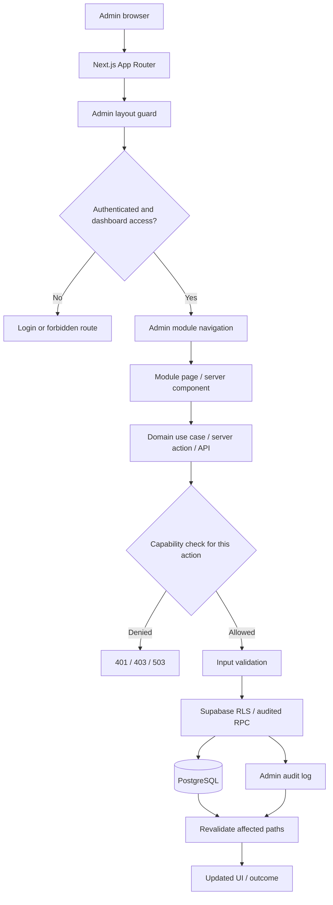
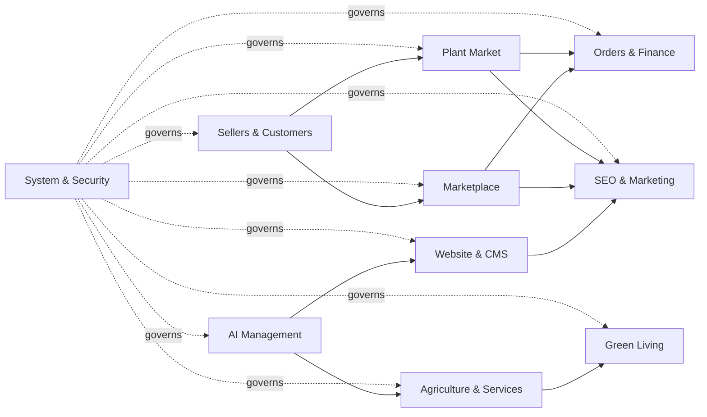

# AGRIVA Admin Control Center — Architecture & Delivery Flow

## Purpose

This document is the implementation baseline for the 11-module AGRIVA Admin navigation. It is intentionally additive: preserve the current public storefront, seller workflows, order lifecycle, and Supabase schema until each change is reviewed and tested.

## Repository baseline (verified against `main`)

- Next.js App Router, React, TypeScript, Tailwind CSS.
- Supabase Auth + PostgreSQL using `@supabase/ssr` and `@supabase/supabase-js`.
- `app/admin/layout.tsx` protects the admin route tree with `requireAdminPage("dashboard.read")`.
- `lib/admin/authz.ts` centralizes the legacy Admin console capability allow-list, currently backed by `profiles.role = 'admin'`; sensitive capabilities such as payment reconciliation and payout approval are deny-by-default.
- `lib/admin/permission-service.ts` is a separate delegated-admin path backed by `has_admin_permission`; it deliberately does not inherit legacy Admin role grants.
- `lib/authz/module-access.ts` checks seller/business/farm module grants through `has_module_access`, with the principal bound to the authenticated Supabase session.
- `supabase/migrations/20261030100000_module_access_foundation.sql` exists in the repository, but production migration drift means its presence in Git does not prove it has been applied to Production.
- Admin Server Actions and API Route Handlers must authorize independently; the layout guard is not a substitute.
- Marketplace and Plant Market are separate product domains and must remain separate.
- Existing CI currently includes lint, TypeScript, regression/smoke checks, and production build.
- Existing middleware refreshes Supabase sessions and clears invalid refresh-token cookies. Keep its behavior covered while addressing the Next.js middleware-to-proxy convention warning in a separate compatibility change.

## Target module map

| Module | Route namespace | Primary capability family | Initial delivery |
|---|---|---|---|
| Dashboard | `/admin` | `dashboard.read` | Existing dashboard; improve navigation/summary incrementally |
| Website & CMS | `/admin/content/*` | `content.read/edit/publish` | Inventory existing article drafts before adding pages/media |
| Marketplace | `/admin/marketplace/*` | `catalog.read/create/edit/moderate` | Reuse products and current admin product RPCs |
| Plant Market | `/admin/plant-market/*` | Separate Plant Market permissions, initially existing admin moderation boundary | Keep table/API/checkout isolated from Marketplace |
| Sellers & Customers | `/admin/people/*` | `users.read`, `identity.review`, explicit suspension grant | Reuse profiles, verification and seller grants |
| Orders & Finance | `/admin/commerce/*` | `orders.read/transition`, dedicated finance grants | Read-only overview first; sensitive operations remain gated |
| Agriculture & Services | `/admin/agriculture/*` | Domain-specific read/moderate grants | Integrate existing farms, crops, jobs, transport and price data |
| Green Living | `/admin/green-living/*` | Domain-specific grants | Reuse Green Exchange/Impact services |
| AI Management | `/admin/ai/*` | New AI configuration/usage grants | Server-only provider secrets; no key exposure to browser |
| SEO & Marketing | `/admin/seo/*` | `content.edit` plus dedicated SEO grants | Canonical, sitemap, redirects and audit |
| System & Security | `/admin/system/*` | `roles.read`, `audit.read`, `system.health.read`; high-risk actions separately gated | Read-only health/audit first |

Routes above are target route namespaces, not a claim that all pages already exist. Build only the pages backed by verified data and working actions; unavailable modules should be clearly marked as planned rather than linked to fake functionality.

## Layered architecture

1. **UI / route layer** — server-rendered `/admin` pages, shared responsive navigation filtered through the current server-verified legacy Admin capability allow-list, forms and accessible states. Delegated role grants remain a separate authorization path until explicitly integrated.
2. **Application/use-case layer** — domain-specific server actions and route handlers; parse and validate inputs before calling persistence.
3. **Authorization layer** — `requireAdminPage`, `requireAdminApi`, capability checks, deny-by-default grants, and explicit high-risk step-up/approval policies.
4. **Domain/persistence layer** — existing Supabase tables, RLS, constraints, narrowly scoped RPCs, migrations and audit records. Do not duplicate existing entities.
5. **Integration layer** — Supabase Storage, payment provider, AI providers and external agriculture services. Secrets stay server-side and outbound calls are validated and observable.

## Request and data flow

Every mutation must repeat authorization at its own server boundary. Never trust hidden inputs, client navigation visibility, browser success redirects, or a layout-only guard.

## Module interaction / bounded-context flow

Arrows describe logical dependencies, not direct database coupling. Cross-domain operations must go through explicit server-side use cases and audited interfaces.

## Core invariants

- Marketplace `public.products` and Plant Market `public.plant_market_products` remain separate domains, APIs, seller rules, permissions, route namespaces and checkout lifecycles.
- Product UUIDs and order references are immutable. Public slugs are identifiers for URLs only.
- Custom slug changes require database uniqueness, atomic history/redirect creation, loop/conflict protection, and canonical/OG/JSON-LD/sitemap updates.
- Seller ownership is read-only in ordinary product editing. Ownership transfer is a separate high-risk operation.
- Financial mutations (refunds, reconciliation, payouts) require separate permissions, server-side verification, idempotency and audit; they are not ordinary admin CRUD.
- AI provider credentials and payment secrets never reach client components or logs.
- Every module needs loading, empty, error, forbidden and success states; responsive and keyboard-accessible navigation.
- Never run migrations against a live project until project identity, migration history, backup/recovery and explicit release approval are confirmed.

## Delivery sequence

### Phase 0 — Audit and safety baseline
- Triage open repository issues and reconcile stale issue descriptions against current `main`.
- Confirm CI and Vercel preview gates.
- Record production schema drift; keep all database inspection read-only.
- Agree on route names and capability ownership before creating pages.

### Phase 1 — Admin shell and access model
- Shared module navigation filters verified links through the server-checked legacy Admin capability allow-list.
- Add module landing pages only where a real destination exists.
- Keep page, API and Server Action authorization independent of navigation visibility.
- Keep high-risk finance actions deny-by-default; commission approval requires `payments.reconcile`, payout approval/completion requires `payouts.approve`.
- Add navigation, destination integrity and finance action regression checks.

### Phase 2 — Catalogue control (first functional vertical slice)
- Marketplace landing page provides database-backed product status counts and links to the existing product editor, seller application queue and taxonomy manager.
- Marketplace product editor: custom slug, category, media, inventory, SEO, preview.
- Plant Market editor as a separate vertical slice with its own validation and permissions.
- Add slug history/redirect and revision/audit support only through reviewed migrations.
- Add collision, redirect, RLS, seller-ownership and canonical metadata tests.

### Phase 3 — CMS and SEO
- Database-backed pages/articles, categories/tags, publication workflow and revisions.
- Homepage builder with allow-listed blocks (never arbitrary HTML).
- Redirect manager, sitemap and SEO audit.

### Phase 4 — People and operations
- Seller/customer/verification tools.
- Orders read/transition, then finance only after payment integrity and idempotency blockers are closed.
- Agriculture/services and Green Living integrations.

### Phase 5 — AI and platform operations
- AI prompts/providers/usage with server-only secrets and cost controls.
- System health, audit search/export, role administration and recovery controls with explicit step-up policies.

Each phase is a separate reviewable PR, with CI + Vercel preview evidence. Do not merge or deploy production automatically.

## Open issue triage (snapshot checked 2026-11-04)

| Issue | Finding | Admin/release impact | Action before release |
|---|---|---|---|
| #15 Dependency security audit | Issue body says Next.js 14.2.31, but current `main/package.json` specifies Next.js 16.4.3 and React 18.3.1. The issue's package snapshot is stale; current transitive audit and a committed lockfile still need verification. | Do not use the issue's old version as a direct upgrade instruction. | Reproduce clean install, generate/review lockfile, run current `npm audit`, map advisories to actual runtime and choose compatible patched versions. |
| #65 Production Supabase migration drift | Production-connected schema is missing several repository tables; migration history differs. | Blocks DB-backed Jobs/feature rollout and any blind migration replay. | Reconcile every migration and live schema; backup/rollback plan; explicit production approval. |
| #68 Payment-event RPC authorization | Historical migration grant is broader than desired; current live grants were read-only verified as denied to anon/authenticated. | Payment-event RPC must not become client callable. | Preserve least privilege; regression-test client denial and trusted server workflow. |
| #69 Forward-only payment-event grant hardening | Repository migration history can encode a less restrictive grant than current live state. | Migration replay could regress payment security. | Reconcile history; add reviewed forward-only revoke/least-privilege migration only after schema-history review. |
| #70 Auth and public SECURITY DEFINER review | Leaked-password protection warning and public RPCs require per-function behavior review. | Security hardening needs compatibility tests; do not revoke public RPCs blindly. | Document intended public surface, validate/rate-limit, review Auth rollout and re-run advisor. |
| #84 SSLCommerz IPN/init hardening | Current `main` has all five SSLCommerz entry points disabled with HTTP 410; the existing smoke test enforces COD-only behavior. The earlier live handler findings are therefore not reachable through those endpoints in the current code. | Online payments remain intentionally unavailable; this is a safe mitigation, not a completed online-payment integration. | Preserve disabled endpoints until a separate verified provider integration, transaction/idempotency design, sandbox suite and approved database rollout are ready. |

Issue descriptions are repository audit records, not a substitute for rechecking the current code and live project immediately before implementing a fix. No issue was closed or marked resolved by this document.

## Implementation progress

- Admin Control Center navigation is mounted under the protected Admin layout and filters links through a server-verified capability list.
- Marketplace module landing page is implemented with read-only product status metrics and verified links to existing workflows.
- Commission/payout Server Actions no longer inherit the broad `dashboard.read` grant; they require explicit finance capabilities and their controls are hidden when those capabilities are unavailable.
- Authorization smoke tests now cover navigation capability filtering, valid route targets, finance action guards, and Marketplace metrics/error behavior.
- SSLCommerz endpoints remain disabled (HTTP 410) and the COD-only smoke test remains in CI. This is a mitigation, not an online payment implementation.

## Immediate implementation backlog

1. Complete Marketplace editor custom-slug, media and SEO workflow only after the required migration is generated through the supported Supabase workflow and schema drift is reconciled.
2. Build Plant Market editor as a separate domain-specific vertical slice.
3. Add slug history/301 redirect tests and canonical metadata checks with reviewed schema changes.
4. Continue CMS, SEO, Sellers, Orders and Finance modules using explicit capabilities.
5. Keep SSLCommerz disabled; reconcile #65 migration drift and #68/#69 RPC grants before any payment migration or online-payment activation.

## Release gates

- CI: lint, TypeScript, all smoke/regression tests and production build pass.
- Vercel preview: deployment READY; verify the changed admin routes and existing public flows.
- Supabase: migration diff, RLS/grants, backup/recovery and target project identity reviewed.
- Security: no client-executable privileged RPCs, no exposed secrets, and all high-risk actions deny by default.
- Release: reviewed PR and explicit production approval. Netlify is not a release gate for this project.
