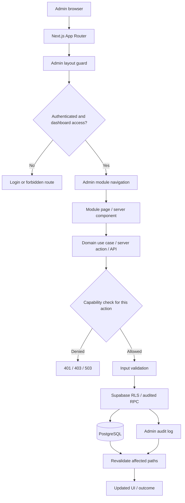
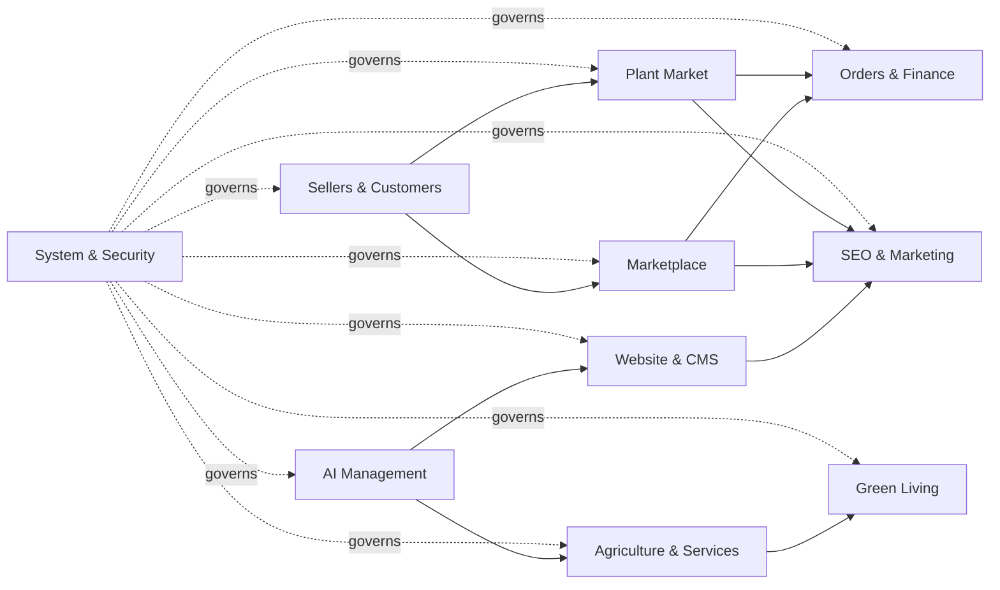

# AGRIVA Admin Control Center — Architecture & Delivery Flow

## Purpose

This document is the implementation baseline for the 11-module AGRIVA Admin navigation. It is intentionally additive: preserve the current public storefront, seller workflows, order lifecycle, and Supabase schema until each change is reviewed and tested.

## Repository baseline (verified against `main`)

- Next.js App Router, React, TypeScript, Tailwind CSS.
- Supabase Auth + PostgreSQL using `@supabase/ssr` and `@supabase/supabase-js`.
- `app/admin/layout.tsx` protects the admin route tree with `requireAdminPage("dashboard.read")`.
- `lib/admin/authz.ts` centralizes the legacy Admin console capability allow-list, currently backed by `profiles.role = 'admin'`; sensitive capabilities such as payment reconciliation and payout approval are deny-by-default.
- `lib/admin/permission-service.ts` is a separate delegated-admin path backed by `has_admin_permission`; it deliberately does not inherit legacy Admin role grants.
- `lib/authz/module-access.ts` checks seller/business/farm module grants through `has_module_access`, with the principal bound to the authenticated Supabase session.
- `supabase/migrations/20261030100000_module_access_foundation.sql` exists in the repository, but production migration drift means its presence in Git does not prove it has been applied to Production.
- Admin Server Actions and API Route Handlers must authorize independently; the layout guard is not a substitute.
- Marketplace and Plant Market are separate product domains and must remain separate.
- Existing CI currently includes lint, TypeScript, regression/smoke checks, and production build.
- Existing middleware refreshes Supabase sessions and clears invalid refresh-token cookies. Keep its behavior covered while addressing the Next.js middleware-to-proxy convention warning in a separate compatibility change.

## Target module map

| Module | Route namespace | Primary capability family | Initial delivery |
|---|---|---|---|
| Dashboard | `/admin` | `dashboard.read` | Existing dashboard; improve navigation/summary incrementally |
| Website & CMS | `/admin/content/*` | `content.read/edit/publish` | Inventory existing article drafts before adding pages/media |
| Marketplace | `/admin/marketplace/*` | `catalog.read/create/edit/moderate` | Reuse products and current admin product RPCs |
| Plant Market | `/admin/plant-market/*` | Separate Plant Market permissions, initially existing admin moderation boundary | Keep table/API/checkout isolated from Marketplace |
| Sellers & Customers | `/admin/people/*` | `users.read`, `identity.review`, explicit suspension grant | Reuse profiles, verification and seller grants |
| Orders & Finance | `/admin/commerce/*` | `orders.read/transition`, dedicated finance grants | Read-only overview first; sensitive operations remain gated |
| Agriculture & Services | `/admin/agriculture/*` | Domain-specific read/moderate grants | Integrate existing farms, crops, jobs, transport and price data |
| Green Living | `/admin/green-living/*` | Domain-specific grants | Reuse Green Exchange/Impact services |
| AI Management | `/admin/ai/*` | New AI configuration/usage grants | Server-only provider secrets; no key exposure to browser |
| SEO & Marketing | `/admin/seo/*` | `content.edit` plus dedicated SEO grants | Canonical, sitemap, redirects and audit |
| System & Security | `/admin/system/*` | `roles.read`, `audit.read`, `system.health.read`; high-risk actions separately gated | Read-only health/audit first |

Routes above are target route namespaces, not a claim that all pages already exist. Build only the pages backed by verified data and working actions; unavailable modules should be clearly marked as planned rather than linked to fake functionality.

## Layered architecture

1. **UI / route layer** — server-rendered `/admin` pages, shared responsive navigation filtered through the current server-verified legacy Admin capability allow-list, forms and accessible states. Delegated role grants remain a separate authorization path until explicitly integrated.
2. **Application/use-case layer** — domain-specific server actions and route handlers; parse and validate inputs before calling persistence.
3. **Authorization layer** — `requireAdminPage`, `requireAdminApi`, capability checks, deny-by-default grants, and explicit high-risk step-up/approval policies.
4. **Domain/persistence layer** — existing Supabase tables, RLS, constraints, narrowly scoped RPCs, migrations and audit records. Do not duplicate existing entities.
5. **Integration layer** — Supabase Storage, payment provider, AI providers and external agriculture services. Secrets stay server-side and outbound calls are validated and observable.

## Request and data flow

Every mutation must repeat authorization at its own server boundary. Never trust hidden inputs, client navigation visibility, browser success redirects, or a layout-only guard.

## Module interaction / bounded-context flow

Arrows describe logical dependencies, not direct database coupling. Cross-domain operations must go through explicit server-side use cases and audited interfaces.

## Core invariants

- Marketplace `public.products` and Plant Market `public.plant_market_products` remain separate domains, APIs, seller rules, permissions, route namespaces and checkout lifecycles.
- Product UUIDs and order references are immutable. Public slugs are identifiers for URLs only.
- Custom slug changes require database uniqueness, atomic history/redirect creation, loop/conflict protection, and canonical/OG/JSON-LD/sitemap updates.
- Seller ownership is read-only in ordinary product editing. Ownership transfer is a separate high-risk operation.
- Financial mutations (refunds, reconciliation, payouts) require separate permissions, server-side verification, idempotency and audit; they are not ordinary admin CRUD.
- AI provider credentials and payment secrets never reach client components or logs.
- Every module needs loading, empty, error, forbidden and success states; responsive and keyboard-accessible navigation.
- Never run migrations against a live project until project identity, migration history, backup/recovery and explicit release approval are confirmed.

## Delivery sequence

### Phase 0 — Audit and safety baseline
- Triage open repository issues and reconcile stale issue descriptions against current `main`.
- Confirm CI and Vercel preview gates.
- Record production schema drift; keep all database inspection read-only.
- Agree on route names and capability ownership before creating pages.

### Phase 1 — Admin shell and access model
- Shared module navigation filters verified links through the server-checked legacy Admin capability allow-list.
- Add module landing pages only where a real destination exists.
- Keep page, API and Server Action authorization independent of navigation visibility.
- Keep high-risk finance actions deny-by-default; commission approval requires `payments.reconcile`, payout approval/completion requires `payouts.approve`.
- Add navigation, destination integrity and finance action regression checks.

### Phase 2 — Catalogue control (first functional vertical slice)
- Marketplace landing page provides database-backed product status counts and links to the existing product editor, seller application queue and taxonomy manager.
- Marketplace product editor: custom slug, category, media, inventory, SEO, preview.
- Plant Market editor as a separate vertical slice with its own validation and permissions.
- Add slug history/redirect and revision/audit support only through reviewed migrations.
- Add collision, redirect, RLS, seller-ownership and canonical metadata tests.

### Phase 3 — CMS and SEO
- Database-backed pages/articles, categories/tags, publication workflow and revisions.
- Homepage builder with allow-listed blocks (never arbitrary HTML).
- Redirect manager, sitemap and SEO audit.

### Phase 4 — People and operations
- Seller/customer/verification tools.
- Orders read/transition, then finance only after payment integrity and idempotency blockers are closed.
- Agriculture/services and Green Living integrations.

### Phase 5 — AI and platform operations
- AI prompts/providers/usage with server-only secrets and cost controls.
- System health, audit search/export, role administration and recovery controls with explicit step-up policies.

Each phase is a separate reviewable PR, with CI + Vercel preview evidence. Do not merge or deploy production automatically.

## Open issue triage (snapshot checked 2026-11-04)

| Issue | Finding | Admin/release impact | Action before release |
|---|---|---|---|
| #15 Dependency security audit | Issue body says Next.js 14.2.31, but current `main/package.json` specifies Next.js 16.4.3 and React 18.3.1. The issue's package snapshot is stale; current transitive audit and a committed lockfile still need verification. | Do not use the issue's old version as a direct upgrade instruction. | Reproduce clean install, generate/review lockfile, run current `npm audit`, map advisories to actual runtime and choose compatible patched versions. |
| #65 Production Supabase migration drift | Production-connected schema is missing several repository tables; migration history differs. | Blocks DB-backed Jobs/feature rollout and any blind migration replay. | Reconcile every migration and live schema; backup/rollback plan; explicit production approval. |
| #68 Payment-event RPC authorization | Historical migration grant is broader than desired; current live grants were read-only verified as denied to anon/authenticated. | Payment-event RPC must not become client callable. | Preserve least privilege; regression-test client denial and trusted server workflow. |
| #69 Forward-only payment-event grant hardening | Repository migration history can encode a less restrictive grant than current live state. | Migration replay could regress payment security. | Reconcile history; add reviewed forward-only revoke/least-privilege migration only after schema-history review. |
| #70 Auth and public SECURITY DEFINER review | Leaked-password protection warning and public RPCs require per-function behavior review. | Security hardening needs compatibility tests; do not revoke public RPCs blindly. | Document intended public surface, validate/rate-limit, review Auth rollout and re-run advisor. |
| #84 SSLCommerz IPN/init hardening | Current `main` has all five SSLCommerz entry points disabled with HTTP 410; the existing smoke test enforces COD-only behavior. The earlier live handler findings are therefore not reachable through those endpoints in the current code. | Online payments remain intentionally unavailable; this is a safe mitigation, not a completed online-payment integration. | Preserve disabled endpoints until a separate verified provider integration, transaction/idempotency design, sandbox suite and approved database rollout are ready. |

Issue descriptions are repository audit records, not a substitute for rechecking the current code and live project immediately before implementing a fix. No issue was closed or marked resolved by this document.

## Implementation progress

- Admin Control Center navigation is mounted under the protected Admin layout and filters links through a server-verified capability list.
- Marketplace module landing page is implemented with read-only product status metrics and verified links to existing workflows.
- Commission/payout Server Actions no longer inherit the broad `dashboard.read` grant; they require explicit finance capabilities and their controls are hidden when those capabilities are unavailable.
- Authorization smoke tests now cover navigation capability filtering, valid route targets, finance action guards, and Marketplace metrics/error behavior.
- SSLCommerz endpoints remain disabled (HTTP 410) and the COD-only smoke test remains in CI. This is a mitigation, not an online payment implementation.

## Immediate implementation backlog

1. Complete Marketplace editor custom-slug, media and SEO workflow only after the required migration is generated through the supported Supabase workflow and schema drift is reconciled.
2. Build Plant Market editor as a separate domain-specific vertical slice.
3. Add slug history/301 redirect tests and canonical metadata checks with reviewed schema changes.
4. Continue CMS, SEO, Sellers, Orders and Finance modules using explicit capabilities.
5. Keep SSLCommerz disabled; reconcile #65 migration drift and #68/#69 RPC grants before any payment migration or online-payment activation.

## Release gates

- CI: lint, TypeScript, all smoke/regression tests and production build pass.
- Vercel preview: deployment READY; verify the changed admin routes and existing public flows.
- Supabase: migration diff, RLS/grants, backup/recovery and target project identity reviewed.
- Security: no client-executable privileged RPCs, no exposed secrets, and all high-risk actions deny by default.
- Release: reviewed PR and explicit production approval. Netlify is not a release gate for this project.

## Production schema reconciliation snapshot (2026-11-04)

Target project confirmed by the user: `dhqaepsbuwhbynagfxpf` (`supabase-coral-clock`, ACTIVE_HEALTHY, PostgreSQL 17.11, us-east-1). All inspection below was read-only; no SQL writes, migrations, data updates, or permission changes were performed.

### Live catalogue schema

- `public.products` has UUID identity, nullable slug with a unique index, SEO title/description/keywords/content/FAQs, image URL/gallery, image variants, image alt-texts, SEO attribute suggestions, category taxonomy, and Marketplace channel fields.
- `public.plant_market_products` has UUID identity, required unique slug, image URL and image array, but no dedicated SEO title/description/content fields.
- Both tables have RLS enabled and domain-specific policies. Marketplace and Plant Market remain separate tables and policies.
- Live product counts at audit time: Marketplace 3; Plant Market 0. No empty or duplicate slugs were observed in either table.
- No slug history/redirect table was found in the inspected public/private table inventory. Custom slug persistence must not ship until atomic history/redirect handling is added and reviewed.

### Migration-history reconciliation blocker

- Repository branch contains 108 SQL migration files under `supabase/migrations`; the live project reports 102 migration-history entries.
- 34 rows match exact repository filename and migration name. Prefix-normalization finds 44 additional candidate pairs; six groups contain duplicate/replay-name ambiguity. After one-to-one pairing, 28 repository files and 24 live history rows still have no safe name-based counterpart. Candidate names do not prove equivalent DDL; the ambiguous groups and unmatched files require content-level intent comparison.
- Several live objects already exist (including product SEO and image fields) despite their creation migration names not matching the current branch filenames. Reconcile each object and migration intent before producing a forward-only migration.
- Next reconciliation work: complete content-level intent mapping for the 28 repository-only files, 24 live-only rows, and six ambiguous replay groups; compare live object definitions against each migration's intended DDL; then generate a minimal reviewed forward-only migration only if a required object change is missing. Do not repair migration history by deleting/reinserting rows or replaying the folder wholesale.

### Security advisor snapshot

- Security advisor reported one anonymous-executable SECURITY DEFINER aggregate RPC: `public.get_green_impact_metrics()`. Its current definition returns aggregate counts and its ACL includes anon/authenticated/service_role. Treat as an intentional public aggregate only after confirming no sensitive row-level data can be inferred; do not revoke blindly.
- Advisor also reported 13 authenticated-executable SECURITY DEFINER RPCs. The inspected Marketplace admin wrappers delegate to private SECURITY DEFINER functions that check `auth.uid()` and `public.is_admin()`; each other RPC still requires per-function authorization review before any grant changes.
- Leaked-password protection is disabled in Auth settings. This is a configuration hardening item, not changed during this read-only audit.
- Performance advisor reported 103 unused indexes; no index was dropped because usage history and workload impact need review.

### Marketplace editor delivery gate

The current editor only saves core product fields and taxonomy. The public product page currently uses generated metadata rather than stored SEO fields and loads only `image_url`. The live schema already contains most Marketplace SEO/media fields, but the current editor does not expose them and slug changes have no redirect history. Implement the UI and public metadata/media consumption only against verified existing fields and tested RPC contracts; defer slug mutation until the redirect-history migration and RPC are reviewed. Plant Market SEO/editor work remains a separate bounded context.

**Release status:** production migration application remains blocked pending full migration-intent reconciliation, backup/recovery plan, advisors review, and explicit release approval. This snapshot does not authorize production DDL or deployment.

## Phase 0 — Production migration/security reconciliation (read-only, 2026-11-04)

Target: `dhqaepsbuwhbynagfxpf` (`supabase-coral-clock`). The user explicitly confirmed this project should be treated as Production. All checks in this section were read-only; no database DDL, data writes, grants, Auth settings, migration-history rows, or production deployments were changed.

### Migration history cross-check

- Branch migration directory: 106 SQL files. Production migration history: 102 rows.
- 34 rows match exact repository filename and migration name.
- 44 additional prefix-normalized candidate pairs were found. Six groups are ambiguous because of duplicate/replay entries (Green Living indexes, truncate privileges, Green Exchange reconcile, Green Living reconcile, atomic cart checkout, and legacy order RPC revocation).
- After one-to-one pairing, 28 repository migration files and 24 production history rows remain without a safe name-based counterpart.
- This establishes migration-history drift, not a list of unapplied migrations. Some repo-only effects may already be present in Production under differently named/renamed history rows. Conversely, a matching filename is not proof that its DDL is identical.
- No attempt was made to repair migration history or replay any migration. Next reconciliation must compare the 28/24 unmatched entries and six ambiguous groups against actual live object definitions and migration SQL intent.

### Security issue cross-check

- Issue #68/#69 payment-event grant hardening: live `public.record_payment_event(uuid,text,text,numeric,text,text,jsonb)` currently has `anon_execute=false`, `authenticated_execute=false`, and `service_role_execute=true`. This is the desired least-privilege runtime state even though the corresponding repository migration name is not an exact live history match. Preserve it; do not re-grant browser execution.
- `public.is_admin()` is currently SECURITY INVOKER (not SECURITY DEFINER), with `anon_execute=false`, `authenticated_execute=true`, and `service_role_execute=true`; this matches authenticated RLS policy usage and keeps anonymous invocation denied. No grant was changed.
- Security advisor reported 13 authenticated-executable SECURITY DEFINER functions and one anon-executable aggregate function. Read-only body review found the 12 user/admin workflow functions require `auth.uid()`; admin-only actions additionally check `public.is_admin()` or the admin profile, while checkout/order/Green Exchange functions include actor/ownership checks. These are intentionally authenticated workflow RPCs, not blanket reasons to revoke EXECUTE. Keep the per-function inventory and regression tests.
- `public.get_green_impact_metrics()` is callable by anon and authenticated but returns aggregate counts only (approved Green Exchange listings, active Marketplace products in a category pattern, completed exchange requests). This appears to be an intentional public aggregate endpoint; assess inference risk and keep its output aggregate-only. Do not revoke without a product compatibility decision.
- Auth leaked-password protection is disabled. This is a real hardening task, but enabling it can affect signup/password update behavior and requires an Auth configuration rollout and user-flow tests; it was not toggled during this read-only pass.
- Performance advisor reports 103 unused indexes and one multiple-permissive-policy warning on `green_exchange_listings`. No index or policy was removed; index usage and policy semantics need workload/behavior review first.
- RLS is enabled on the inspected Marketplace, Plant Market, order and admin audit tables. RLS is not forced on all of them; do not infer that table owners/service-role access is constrained by RLS.

### Phase 0 exit decision

**Status: partially reconciled; no production mutation.**

The security state for payment-event RPC grants is confirmed safe. SECURITY DEFINER warnings have been classified by function intent rather than blindly revoked. Migration drift is quantified, but content-level reconciliation of all 28/24 unmatched entries and six replay groups remains a blocker to any migration application. Auth leaked-password protection and public aggregate exposure review remain open hardening items. No production migration can be declared ready yet.

## Phase 1 — Responsive Admin Shell implementation (branch work)

- Added a shared responsive shell under the protected `/admin` layout.
- Desktop: persistent 264px sidebar, module grouping, active-route state, searchable navigation and user-dashboard shortcut.
- Mobile: four primary bottom-navigation destinations (Home, Orders, Marketplace, Plant Market) plus a searchable More sheet; safe-area padding and 48px touch targets.
- Navigation links are filtered individually by their server-verified capability. Every destination still enforces its own server-side access checks.
- Planned features are rendered as non-clickable labels. The shell does not fabricate routes for unfinished modules.
- Dashboard now uses a pending-order count query rather than loading every order amount to compute an all-time value; recent orders render as cards on mobile and a table on desktop.
- The existing `/admin/orders` route still has its own legacy admin role check. A future capability migration should align that route with `orders.read`/transition policies before delegated admins are introduced.

## Marketplace vertical slice progress

- Marketplace overview remains database-backed and read-only for status metrics.
- Product editor now supports server-side name search and status filters, core product fields, taxonomy, SEO title/description/keywords/content/FAQ, gallery inspection, and per-image alt text through the existing admin-guarded SEO RPCs.
- The public Marketplace product page consumes saved SEO title/description/keywords, SEO content, image gallery and alt text; saved FAQ entries are displayed and emitted as FAQ structured data. UUID fallback and canonical slug redirect behavior remain.
- Existing image URLs are view-only in Admin. Production Storage policies inspected so far authorize seller-owned uploads, not a reviewed Admin upload flow; no client-side policy bypass was added.
- Custom slug editing, slug history and 301 redirect persistence remain blocked until a forward-only migration/RPC design is reviewed and the full production migration map is reconciled.
- Marketplace and Plant Market remain separate data and moderation domains.

### Verification status for this implementation slice

- Static source-contract checks were added to `smoke-admin-authorization.mjs` and `smoke-marketplace-product-seo.mjs`.
- GitHub Actions and Vercel preview results for the latest commit are pending; no successful build, lint, typecheck or route verification is claimed until those checks finish.
- No PR merge, production deploy or production database write was performed.
### Additional financial-action boundary found during Phase 1

- The legacy `/admin/orders` page previously allowed COD collection after only checking `profiles.role = 'admin'`. It now uses `orders.read` for the page, `orders.transition` for delivery status changes, and `payments.reconcile` for the COD collection Server Action. The collection form is hidden unless that separate capability is available.
- `payments.reconcile` remains deny-by-default in the current legacy capability allow-list, so no existing admin receives COD collection permission from this UI until a separately reviewed grant model exists. The database RPC continues to require its own admin check.
- The main dashboard no longer offers `refunded` as an ordinary order status. Refunds remain outside routine order transitions and require a dedicated reviewed workflow.
- Regression checks were added for both boundaries. No Production grants or payment records were changed.
- Dashboard commission and payout data queries are now skipped unless `payments.read`/`payments.reconcile` or `payouts.read`/`payouts.approve` is available. The corresponding KPI and panels show restricted/unavailable state rather than a misleading zero.
- `/admin/orders` skips checkout collection-ledger queries without `payments.read`; order details remain available under `orders.read`. The COD reconciliation form remains hidden unless `payments.reconcile` is separately granted.
- Dashboard recent-order preview no longer fetches the full `shipping_address` JSON just to display a buyer name; it selects only the buyer profile's `full_name`.
### Important residual: capability checks are not yet enforced inside every finance RPC

- The app-level `payments.reconcile` / `payouts.approve` checks now hide finance UI and protect the Server Actions, but Production finance RPCs still grant EXECUTE to `authenticated` and their private SECURITY DEFINER implementations check `public.is_admin()`. Examples include `approve_reseller_commission`, `approve_commission_payout`, `complete_commission_payout`, and `record_cod_collection`.
- Therefore an authenticated legacy admin could call those RPCs directly and bypass the new app-layer capability boundary. This is a release blocker before introducing delegated Admin roles or claiming finance capabilities are database-enforced. A reviewed migration must add database-side capability grants/checks or move these operations behind a service-role-only RPC invoked exclusively after server-side capability authorization.
- Production `public.set_marketplace_order_status(uuid,text)` also still accepts `refunded` in its admin branch and restores stock/reverses commissions. The Dashboard and Orders UI no longer expose refund status, but direct authenticated Admin RPC invocation can still request it. A dedicated refund workflow and DB-level restriction remain required.
- No RPC grants or function bodies were changed in Production. The UI restrictions are mitigation only, not a complete database security fix.
### Object-level equivalents confirmed for selected unmatched migration intents

- The reseller payout reservation/partial-settlement behavior exists in Production under renamed RPCs: `private.request_commission_payout(numeric,text)` locks the reseller profile, computes approved unpaid commission, subtracts requested/approved payouts, and rejects over-reservation; `private.complete_commission_payout(uuid,text)` locks the approved payout and commission rows, allocates `paid_amount` across commission rows, and rejects insufficient approved balance. These are functional equivalents to the intent of the repository payout-reservation/partial-settlement migrations, but their current authenticated wrappers still rely on the legacy admin role rather than DB-side capability grants.
- `public.set_marketplace_order_status(uuid,text)` exists as SECURITY DEFINER, requires `auth.uid()`, checks admin or verified seller organization/module access, and enforces seller transitions. Its admin branch still accepts `refunded`, so the routine UI restriction does not close direct RPC invocation.
- `public.handle_new_user()` exists as SECURITY DEFINER with EXECUTE limited to service_role, and `public.user_role_memberships` exists. The `profiles` table has a `prevent_role_escalation` trigger and its authenticated update policy is owner-only; admin reads use the private admin predicate.
- `harvest_listings_publish_immediately` trigger and the public `status = 'available'` read policy exist. Owner status updates remain constrained to approved moderation state; the publish trigger is the path that reconciles immediate publication.
- These checks reduce uncertainty for several high-impact migration intents, but do not replace the outstanding full DDL comparison for all unmatched and ambiguous migration entries.
### Updated content-level migration reconciliation (read-only, 2026-11-04)

- The normalized filename audit was rerun against the current branch and live `supabase_migrations.schema_migrations` list: 108 repo files, 102 history rows, 71 unique pairs, six ambiguous duplicate-name groups (8 repo entries / 11 DB entries), 29 repo-only names and 20 DB-only names. This supersedes the earlier 34/44 estimate.
- Live catalog inspection confirms `user_role_memberships`, `content_drafts`, Green Exchange tables, Green Living tables, crop-cycle/farm-finance tables, `paid_amount`, payout RPCs, attribution RPCs, and the Harvest immediate-publication trigger exist. Some have renamed or consolidated migration history.
- `learning_correction_reports` and `content_draft_revisions` are absent from the inspected Production schema; the corresponding unmatched migrations must not be marked applied. The `content_drafts` table exists but only the `content_drafts_admin_all` policy was visible in the policy inventory; the repo's public published-article column grant/policy was not found in that inventory. Do not enable the public article route on the assumption that its migration ran.
- `farm_expenses_owner_insert/update` live policies were present, but their crop-cycle ownership predicates were not confirmed by the catalog snapshot; the repo's `fix_farm_record_crop_cycle_scope` intent remains an explicit compare item.
- `paid_amount` and the payout functions exist in Production, but the inspected public `complete_commission_payout(uuid,text)` reports SECURITY INVOKER while the earlier private implementation/wrapper inventory showed a SECURITY DEFINER implementation. Compare the full schema-qualified function definitions and grants before treating payout settlement as fully reconciled.
- The repo's payment-event hardening intent is confirmed live: `record_payment_event` is executable only by `service_role` (anon/authenticated denied). The anon resolver restriction and public attribution output minimization must still be compared by exact function ACL and body, not inferred from object existence.
- Green Exchange and Green Living tables exist; Production policy set includes an extra authenticated admin-read policy for Green Exchange. Review the multiple-permissive-policy advisor warning against these exact policies; do not drop policies as part of reconciliation.
- This narrows the remaining work to content/DDL comparison for the 29 repo-only, 20 history-only and six ambiguous groups. It does not authorize replay, history editing, or a new migration. Keep Production read-only until a signed-off forward-only diff is produced.
### Next implementation slice — Plant Market editor

- Added `/admin/plant-market` as a separate catalog workspace, with server-side name/status filters and a mobile-first product editor for plant-specific fields (scientific name, category, care, size, age, price, stock, unit, delivery area, description).
- Added PATCH API guarded by `catalog.edit`, using the existing Production `plant_market_products` table, RLS admin policy and database write trigger. Active products are prechecked against verified Gardener identity and an unexpired global Plant Market create grant; the database trigger remains the final enforcement boundary.
- Slug and publication status are not editable here; moderation remains in the separate `catalog.moderate` queue. Images/gallery are read-only because an Admin Storage ownership/policy design is still pending. No migration or Storage policy change was introduced.
- Plant Market edit API now fails closed if the server-only `SUPABASE_SERVICE_ROLE_KEY`/Supabase URL is unavailable. Before product mutation it records `plant_market.product.update_requested` in `admin_audit_log` through a server-only service-role client; it then marks the event completed/failed. The product update itself still runs through the authenticated user's Supabase session so the existing RLS policy and `guard_plant_market_product_write()` trigger remain in force.
- The audit insert happens before the mutation; if the audit service is unavailable, no product write occurs. If final audit status update fails after the product update, the initial attempted event remains and the API returns a visible audit-finalization error. No service-role secret is sent to the browser.
- Plant Market editor validates the live database constraints: price must be greater than zero; stock cannot be negative; unit is restricted to `piece`, `pot`, `pack`, or `tray`; category label and required kebab-case `category_slug` are updated together. This was confirmed against the Production `plant_market_products` table constraints by read-only catalog inspection.
### Sellers & Customers — responsive user management slice

- `/admin/users` now supports server-side name search and role filters, with desktop table and mobile cards. User IDs are masked in the UI; query failures show an alert instead of a false empty state.
- Navigation and Dashboard shortcut require `users.read`; role mutation remains a separate `roles.grant` Server Action and the existing database RPC. Routine UI can only switch Farmer/Reseller and cannot promote an Admin or change the signed-in admin's own role.
- Identity verification queue now returns explicit success/validation/failure notices after Server Action review instead of throwing an unhandled error. Rejection requires a review reason, applicant IDs are masked, and action controls use mobile-sized touch targets.
### Critical live attribution RPC drift found and forward-only repair drafted

- Exact Production function inspection found `public.record_attribution_session(text,text,uuid,integer)` still returns `attribution_sessions` and has EXECUTE for `anon` and `authenticated`; its private SECURITY DEFINER implementation also had client-role EXECUTE. The referral redirect only consumes success/failure, so this exposes an unnecessary inserted row to anonymous callers.
- Exact Production ACL inspection found `public.resolve_reseller_attribution(text,text,uuid)` still has EXECUTE for `anon` and returns `reseller_id`/`expires_at`, contrary to the repo's intended authenticated-only resolver migration.
- Added `supabase/migrations/20261104100000_forward_harden_attribution_rpcs.sql`: the public attribution creation RPC becomes `RETURNS void`, client roles lose direct access to the private row-returning implementation, and anonymous execution is revoked from public/private attribution resolution while authenticated/service-role access remains.
- Added smoke assertions for the forward migration. This is a draft forward-only repair on the feature branch only. It has NOT been applied to Production; migration-history reconciliation and explicit Production migration approval are still required.
### Finance RPC bypass and refund state machine — forward-only repair drafted

- Production exact ACL/definition inspection confirmed authenticated EXECUTE on public/private `approve_reseller_commission`, `approve_commission_payout`, `complete_commission_payout`, and `record_cod_collection`; their SECURITY DEFINER bodies use the legacy admin predicate, not fine-grained capabilities.
- Added `supabase/migrations/20261104110000_forward_harden_admin_finance_and_order_rpcs.sql`. It revokes client/service-role execution from those legacy high-risk finance RPCs until a new audited server-side actor-verified finance workflow is introduced. This intentionally fails closed; current Admin finance capabilities are denied by default.
- The same migration replaces the private order transition implementation with an explicit state machine, revokes direct client execution of the private implementation, and exposes only a guarded public wrapper. Direct `refunded` status is removed; refund requires a separate workflow. Stock is restored only for pending/processing cancellation, never after dispatch.
- Dashboard and Orders screens now display only valid next-state options for the current order status, matching the forward migration's state machine.
- Static regression assertions were added. This migration is branch-only and NOT applied to Production. Full migration history reconciliation and explicit approval remain required.