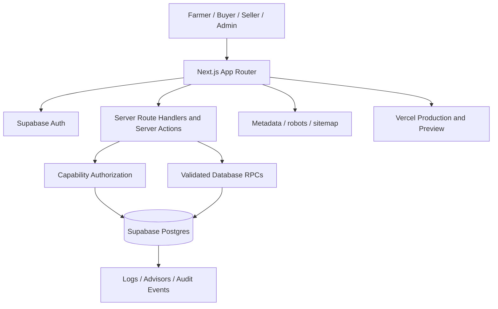

# AGRIVA Target Architecture

**Status:** Target-state architecture and release guardrails  
**Baseline:** Production audit completed 2026-10-30  
**Scope:** Next.js application, Supabase identity/database, marketplace, COD order operations, deployment and observability

## 1. Architecture principles

1. **One identity, explicit authority.** Supabase Auth identifies the user. A profile or role membership is not, by itself, permission to perform every action. Admin operations require named server capabilities and an independent database authorization check.
2. **Database is the source of truth.** Prices, stock, order state, payout balances and publication state are validated in PostgreSQL/RPCs, not trusted from browser payloads.
3. **RLS plus SQL privileges.** Every exposed table has RLS, but RLS is not a substitute for table ACLs. Client roles must not receive destructive privileges such as TRUNCATE.
4. **COD-only until a separate payment decision.** Checkout creates COD orders. Payment collection and fulfilment are separate state machines. No online gateway initiation or callback may mutate order state while COD-only is in force.
5. **Forward-only schema evolution.** Production migration versions are immutable. New changes use unique timestamps greater than the highest applied version; never reuse or edit an applied version.
6. **Small, testable releases.** One domain change per PR, static and SQL regression tests, preview where available, then explicit release gates.

## 2. Logical system

### Application layer

- **Next.js App Router** owns public pages, authenticated workspaces, admin screens, metadata, sitemap and route handlers.
- **Server Components** perform read-side queries with the server Supabase client.
- **Client Components** handle interaction only; they send minimal payloads to server endpoints and never decide authority or final price.
- **Route Handlers and Server Actions** validate input, resolve the current user with server-side `auth.getUser()`, enforce a capability, and call a narrow database operation.
- **Public SEO surface** includes canonical metadata, robots rules and a sitemap whose database queries are resilient to optional modules being absent.

### Identity and authorization layer

- Supabase Auth is the single user identity provider.
- `profiles` holds the user profile; role membership tables describe business roles such as farmer, seller and organization.
- Public role membership must never imply platform-admin authority.
- Admin UI pages use the shared `lib/admin/authz.ts` guard and named capabilities (for example, `catalog.read`, `orders.manage`, `harvest.read`).
- Every API endpoint independently authenticates and authorizes; the admin layout is not an API security boundary.
- Database policies/RPCs repeat authorization at the data boundary. Production currently uses the private admin helper `private.is_admin()`; policy changes must match the deployed helper and grants.
- User-editable metadata is not an authorization source. Use trusted server-side role records or app metadata controlled by the backend.

### Data layer

- **Supabase Postgres** is authoritative for users, product catalogue, harvest listings, buyer demands, transport bookings, carts, orders, stock, commissions, audit records and module access.
- Keep exposed application tables in `public` behind RLS and least-privilege grants.
- Keep internal helpers and privileged implementation details in a non-exposed schema such as `private`.
- Use SECURITY INVOKER by default. Any SECURITY DEFINER function needs a narrow purpose, fixed search_path, explicit identity/authorization checks, and restricted EXECUTE grants.
- RPCs that change multiple related rows (checkout, stock reservation, order transitions, payouts) must be transactional and idempotent where retries are possible.
- Keep audit records for consequential admin, moderation, payout and access-control actions.

## 3. Domain boundaries and primary flows

### Marketplace catalogue

1. Seller/organization submits product data, price, unit, stock and media.
2. Server validates seller membership and field limits.
3. New products remain drafts or pending moderation.
4. Authorized moderators approve, reject or request correction through a narrow audited action.
5. Public catalogue, product detail pages, structured data and sitemap expose only active, approved products.

**Invariant:** sellers cannot set commission, bypass moderation, or directly publish a product by forging client fields.

### Sell My Harvest

1. Authenticated farmer submits crop, quantity, unit, price, location and optional contact information.
2. The publication trigger forces the compatibility moderation value to `approved`; public visibility is controlled by `status = 'available'`.
3. Owners can pause, resume or mark their own listing sold out; admins retain scoped oversight.
4. Phone details are stored/exposed only when the farmer explicitly opts in (`contact_phone_public = true`).

**Invariant:** immediate publication never overrides phone-consent privacy or owner boundaries.

### Buyer demand and transport

- Buyer demand records describe a crop/quantity/location request.
- Farmers respond to a demand; the buyer chooses a response outside the initial listing step.
- Transport bookings and quotes have their own owner/partner/admin policies.
- Contact details are exposed only to parties with an explicit business need and the relevant policy.

### Cart, checkout and COD orders

1. Buyer adds products to a cart; the browser sends product IDs and quantities only.
2. Server/database reload current price and stock.
3. A single transactional checkout RPC validates ownership, stock, price, address and COD payment method; it creates order records and reserves/decrements inventory atomically.
4. Order fulfilment state (pending, processing, shipped, delivered, cancelled) is distinct from COD collection state (not collected, collected, reconciled).
5. Cancellation/restock is guarded against duplicate transitions and only occurs for eligible pre-shipment states.
6. Admin order desk updates use the current authorized RPC and audit consequential changes.

**Invariant:** COD is the only payment method. Disable the online-payment initiation route as well as legacy success/fail/cancel/IPN callbacks. Never treat “delivered” as proof that cash was collected.

### Content and SEO

- Editorial content follows draft → review → publish.
- Canonical URLs and metadata are generated from authoritative slugs.
- Sitemap generation must not fail because an optional feature table or RPC is unavailable; optional URLs should be guarded or the feature temporarily excluded.
- Structured data must match visible content and must not invent reviews, ratings or availability.

## 4. Security and data-access matrix

| Actor | Public catalogue | Own products/listings | Other users' private data | Admin operations |
|---|---|---|---|---|
| Anonymous | Read approved/available only | None | None | None |
| Authenticated buyer | Read public inventory | Own cart/orders | No | None |
| Farmer | Read public inventory | Own harvest listings and demand responses | No | None |
| Seller / organization | Read public inventory | Own product submissions | No | None |
| Transport partner | Read public inventory | Assigned bookings/quotes | Only assigned contact data | Scoped partner actions |
| Admin | As authorized | Scoped operational data | Only capability-required fields | Named capability + DB authorization |

All rows in this matrix are subject to the actual table-specific RLS policies and grants. This matrix is a design contract, not a blanket grant.

## 5. Deployment and migration pipeline

```mermaid
flowchart LR
  A[Issue / audit finding] --> B[Small branch from current main]
  B --> C[Static smoke tests]
  C --> D[SQL / RLS integration test]
  D --> E[GitHub CI: lint, types, build]
  E --> F[Preview review]
  F --> G[Migration rehearsal on disposable/staging DB]
  G --> H[Review migration history and backup]
  H --> I[Production migration + deployment]
  I --> J[Post-release SQL, route and log checks]
```

### Migration rules

- Read Production migration history before naming a migration.
- Migration timestamp must be unique and strictly greater than the latest applied Production version.
- Migrations are forward-only and idempotent where safe; do not edit already-applied migration files.
- Test the migration on a clean PostgreSQL/Supabase rehearsal database and against a schema representative of Production.
- Confirm RLS, grants, default privileges, function ownership, EXECUTE ACLs, indexes and data normalization.
- Production apply and deploy are separate release actions with rollback/forward-fix plans.

### Release gates

- GitHub CI passes (lint, TypeScript, regression tests, production build).
- SQL/RLS integration tests pass for anonymous, authenticated owner, non-owner and admin contexts.
- Preview is from the exact commit under review. If preview infrastructure is quota-blocked, record the limitation; do not promote a stale deployment.
- Database migration history is reconciled and backup/restore plan is known.
- Post-release checks confirm key routes, RPCs, RLS, ACLs, order flows and logs.

## 6. Production audit findings to close

| Priority | Finding | Required action |
|---|---|---|
| P0 | `anon` and `authenticated` can TRUNCATE `buyer_demands` and `transport_bookings` | Revoke existing grants and default privileges; verify with SQL regression test |
| P0 | Harvest publication migration version collides with Production; Production still gates public reads on approved status | Use a new forward migration matching `private.is_admin()`; verify legacy normalization and phone consent |
| P1 | Green Exchange, Garden and Green Impact API queries return missing-relation/RPC errors | Reconcile schema and RLS or feature-flag/hide routes and sitemap references |
| P1 | Sitemap queries an unavailable Green Exchange relation | Make optional sitemap sources fail-safe |
| P1 | Invalid refresh-token errors occur in middleware | Review refresh race/stale cookie handling; fail closed and avoid redirect loops |
| P1 | Online-payment initiation/callback routes remain despite COD-only policy | Disable initiation and all callback state transitions |
| P2 | No committed package lockfile | Commit one lockfile and use deterministic `npm ci` |
| P2 | Low production inventory and limited transaction volume | Prioritize real farmer/seller onboarding and end-to-end COD fulfilment over adding more modules |

## 7. Operational observability

Track:
- API errors by route and Supabase error code (especially missing relation/function and schema-cache errors).
- Auth refresh failures, session renewal outcomes and redirect loops.
- Checkout conversion, stock conflicts, duplicate submissions and failed order transitions.
- COD collected vs delivered discrepancies and reconciliation backlog.
- Listing/product publication failures and moderation turnaround.
- Sitemap generation errors, crawl/indexability and real field Core Web Vitals.

Do not infer SEO rankings, traffic or Core Web Vitals from a successful build. Use Search Console, analytics and field telemetry.

## 8. Immediate execution order

1. Close the TRUNCATE privilege gap with a forward-only migration and PostgreSQL regression test.
2. Correct the harvest publication migration and Production RLS mismatch.
3. Reconcile missing Green Exchange/Garden/Green Impact relations and make sitemap queries resilient.
4. Enforce COD-only at every payment entry point.
5. Reconcile cart/checkout/order operations and validate stock atomicity.
6. Add deterministic dependency installation and repair refresh-token handling.
7. Merge small seller acquisition and checkout UX improvements after CI/preview checks.
8. Run a limited farmer–buyer pilot; measure actual listings, orders, delivery and COD collection before expanding feature scope.

## 9. Non-goals until the core is stable

- No additional payment gateway.
- No wholesale merge of stale, oversized feature branches.
- No public release of a module whose production schema/RLS/RPC is missing.
- No broad admin role grants or privileged UI without matching API and database authorization.
- No claim of verified farmer, product, rating or transaction quality without a real verification process.
